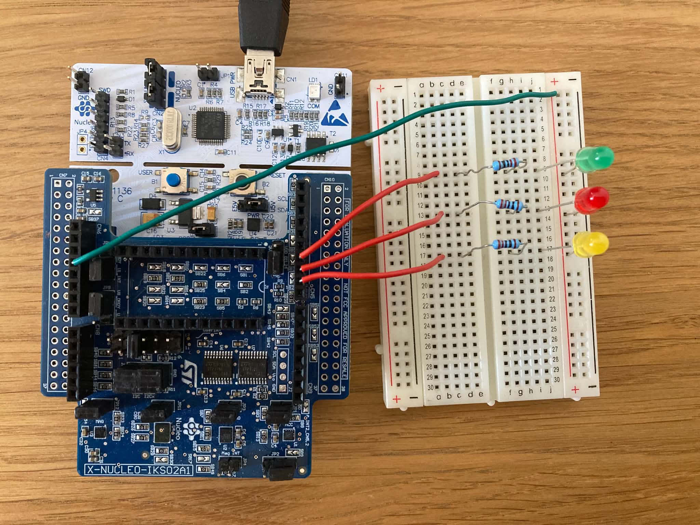

# STM32f411 Voice interaction

## Project Description

This project demonstrates voice interaction on the NUCLEO-STM32f411RE board using STM32's audio package and TinyKW library.
The NUCLEO board is connected to the IMP34DT05 digital microphone located on a X-NUCLEO-IKS02A1 expansion board.
The MCU accesses the PDM data via the SPI/I2S protocol and DMA saves it to a buffer in SRAM. 
Once the half-buffer interrupt triggers, the PDM data is converted to PCM using STM32's PDM2PCM library.
PCM data is then processed to detect keywords using TinyKW library.

## Demo

https://github.com/user-attachments/assets/4fa679fd-4fd8-4727-9687-660d7c79d8c7

## Hardware setup

- PA7 -> R 220 -> cathode Green LED -> +3V3
- PB6 -> R 220 -> cathode Red LED -> +3V3
- PC7 -> R 220 -> cathode Yellow LED -> +3V3

In this setup, setting an output pin HIGH will turns the LED off, and setting it LOW turns the LED on.

## Software setup

1. Install TinykW:
    - Download and unzip the release file of TinykW for cortex-m4 from the [release page](https://github.com/alexpg05/tinykw/releases).
    - Rename the output folder to `Libs`, and place it at the root of this directory.
2. (should be automatic) Install PDM2PCM:
    - PDM2PCM is part of the STM32CubeF4 MCU Package and should normally be automatically downloaded and included into the project when the `Generate Code` function is triggered on STM32CubeMX.
    - If that's not the case, a manual download and installation can be attempted. See https://www.st.com/en/embedded-software/stm32cubef4.html.
3. Generate the code:
    - Open STM32CubeMX and load the project stm32f411-voice-interaction.ioc.
    - Click on `Generate Code` to generate the code.
    - Verify that the folders Drivers, Middlewares (with PDM library in it) and PDM2PCM were created at the root of this directory.
4. Build and run:
    - Open STM32CubeIDE and import this directory as a project. Try building the project and running it with the nucleo board connected.

## Using another language

By default, the English version of TinyKW library is included. To use a different language, the path of the library needs to be modified. This can be done as follows;
- In STM32CubeIDE, Select the project, then `File` > `Properties` > `C/C++ Build` > `Settings` > `MCU/MPU GCC Linker` > `Include Path`
- Modify the path `./Libs/lib/en` into `./Libs/lib/<language>`. Possible values for `<language>` are `en`, `fr`, `de`, `es`, `it`, `pt`, `zh`, `ja`.

## Using other keywords

To use other keywords, their byte representations needs to be retrieved from the TinyKW web console and pasted into the file [keywords.c](Core/Src/keywords.c). The preprocessor macro `NB_KEYWORDS` in [keywords.h](Core/Src/keywords.c) might also need to be adapted to reflect the new number of keywords. Byte representation of keywords must match the language used. If necessary, the detection threshold can be adapated using the preprocessor macro `DETECTION_THRESHOLD`. Please refer to TinyKW documentation for more details.

## License

The code in this repository is licensed under MIT. STM32CubeMX's generated code, STM32's PDM2PCM library and TinyKW are not bundled and remain subject to their own license.
